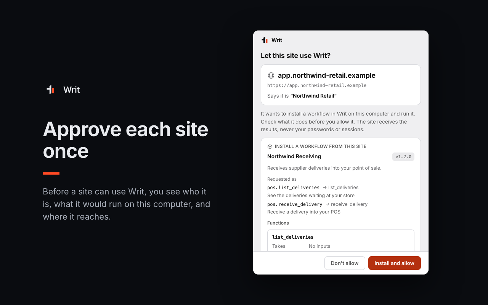

<div align="center">
  

  <h1>Writ for websites</h1>

  <p>Your website calls Writ workflows. They run on each visitor's own computer.<br>
  Your server checks every result against a receipt that Writ signed.</p>

  <p>
    <a href="./docs/quickstart.md"><b>Quickstart</b></a> ·
    <a href="./docs/how-it-works.md"><b>How it works</b></a> ·
    <a href="./docs/packages.md"><b>Shipping workflows</b></a> ·
    <a href="./docs/security.md"><b>Security</b></a> ·
    <a href="./docs/contract.md"><b>Wire contract</b></a> ·
    <a href="./examples/"><b>Examples</b></a>
  </p>
</div>

---

A website calls the Writ workflows it ships, or ones the user already has in Writ. Each call goes
from your page to the Writ browser extension (Chrome or Edge), then to Writ desktop on the same
computer, and runs there. The run uses the user's network and IP address, reaches devices on
their local network that they approved, and signs in with credentials that never leave their
machine. Your page gets the result. Your server gets a receipt that Writ signed, so it can tell a
real result from one a script made up. Nothing runs on your servers, and in `required` mode
nothing goes through a Writ account.

```
  your page  (@usewrit/web)
      |  window.writ
      v
  Writ extension  (Chrome / Edge)
      |  native messaging, same computer
      v
  Writ desktop  (writ-agentd) ------>  the sites your workflow calls
      |                      \----->  devices on the user's network (approved hosts only)
      |  result + signed receipt
      v
  your page  ------------------------>  your server  (@usewrit/server / usewrit)
                                        verifies the receipt before trusting the result
```

This repository holds the guides, the public wire contract and runnable examples. The SDK source
lives in [usewrit/writ-sdks](https://github.com/usewrit/writ-sdks) (`web/`, `server-node/`,
`usewrit-python/`).

## Try it in 5 minutes

You need [Writ desktop 1.0.8 or later](https://usewrit.app/desktop) and the Writ extension in
Chrome or Edge on your own computer.

**1. Export the contract.** Build and test a workflow in Writ desktop, and give each callable part
a function name. Then open **Connect**, **Connected apps**, and in **Websites** choose
**Add to your website**. Pick the functions, give each a key (`pos.lookup`), and download
`writ-contract.json` and `writ-functions.d.ts`. From a terminal:

```bash
writ package export "POS lookup" --function lookup --key pos.lookup --out writ-contract.json
```

**2. Add `@usewrit/web` and call the function from your page.**

```bash
npm install @usewrit/web
```

```ts
import { createWritBridge } from "@usewrit/web";
import contract from "./writ-contract.json";
import type { WritFunctions } from "./writ-functions";

const writ = createWritBridge<WritFunctions>({ contract, app: "Northwind Retail", mode: "required" });

const postJson = (url: string, body: unknown) =>
  fetch(url, { method: "POST", headers: { "Content-Type": "application/json" }, body: JSON.stringify(body) })
    .then((r) => r.json());

const sku = "A-100";
const { challenge } = await postJson("/api/lookup/challenge", { sku });
const { data, receipt } = await writ.pos.lookup({ sku }, { challenge }); // runs on this computer
await postJson("/api/lookup/verify", { challenge, data, receipt });
```

The bridge shows a banner by itself. It walks the visitor through adding the extension, getting
Writ desktop, and installing your workflow in one click.

**3. Verify on your server.**

```bash
npm install @usewrit/server
export WRIT_BRIDGE_SECRET="$(openssl rand -base64 48)"
```

```ts
import { createWritBridge } from "@usewrit/server";

const writ = createWritBridge({ contract, mode: "required" }); // reads WRIT_BRIDGE_SECRET

// POST /api/lookup/challenge { sku }: one single-use challenge for the signed-in user
const challenge = writ.challenge({ subject: user.id, key: "pos.lookup" });
pending.set(challenge, sku); // remember what this user asked for

// POST /api/lookup/verify { challenge, data, receipt }
const check = await writ.verify(receipt, {
  challenge,
  key: "pos.lookup",
  subject: user.id,
  origin: "https://app.northwind.example",
  data,
  inputs: { sku: pending.get(challenge) }, // the call ran with exactly these inputs
});
if (!check.ok) throw new Error(check.reason); // forged, replayed, altered, failed or another computer
```

**4. Open your page.** For local work, serve it on `http://127.0.0.1` and turn on **Developer
mode** in the extension's options. Production sites must use `https`.

The full walk-through, with Python, settings and linked workflows, is in
[docs/quickstart.md](./docs/quickstart.md). The [examples](./examples/) run as they are.

## Packages

| Package | Where it runs | Install |
|---|---|---|
| [`@usewrit/web`](https://www.npmjs.com/package/@usewrit/web) 0.2.0 | Your page. Talks to the extension, shows the setup banner, makes typed calls. | `npm install @usewrit/web` |
| `@usewrit/web` script tag | Your page, without a bundler. Defines `window.WritWeb`. | `<script src="https://cdn.jsdelivr.net/npm/@usewrit/web@0.2.0/dist/writ-web.iife.js"></script>` |
| [`@usewrit/server`](https://www.npmjs.com/package/@usewrit/server) 0.1.0 | Your Node 18+ server. Verifies receipts, hosts the page channel, mints challenges and tokens. | `npm install @usewrit/server` |
| [`usewrit`](https://pypi.org/project/usewrit/) 0.1.0 | Your Python 3.10+ server. The same API in snake_case, with a FastAPI router and an ASGI app. | `pip install usewrit`, `pip install "usewrit[fastapi]"`, `pip install "usewrit[redis]"` |

## Three modes

One setting, `mode`, decides where each function runs. Your calls stay the same in every mode.

| `mode` | The user has Writ and granted your functions | The user doesn't |
|---|---|---|
| `required` | Runs on their computer | A banner walks them through installing Writ and your workflows. Page calls wait. Server calls fail with `USER_OFFLINE` or `WRIT_REQUIRED`. |
| `recommended` | Runs on their computer | A banner suggests Writ and can be closed. Calls run on Writ Cloud, in your account. |
| `cloud` | Runs on Writ Cloud | Runs on Writ Cloud. No banner. |

- `required` needs no Writ Cloud account, no API key and nothing published.
- `recommended` and `cloud` need `WRIT_API_KEY` on your server and a contract downloaded from Writ
  Cloud, which maps each function to your cloud workflow.
- A function that reaches the user's local network is always `required`. Writ Cloud cannot reach
  that network, and the SDKs refuse any other mode for it.
- There is never an automatic fallback. A call that fails on the user's computer fails; it is not
  re-run on Writ Cloud.

## What your users see



- **The consent window.** Before a site can use Writ, the user sees its address, the name it
  gives, each function with its inputs and outputs, every host the workflow reaches, a field per
  credential, and any setting such as their POS address. They click **Install and allow** or
  **Don't allow**. Your page cannot draw, script or click this window.
- **The write confirmation.** A function that changes data shows **Allow this change?** before
  each run, with the values it will use, unless the user turned that off when connecting.
- **The start window.** If Writ is not running, a site's request opens **Start Writ for this
  site?** with **Start Writ** and **Not now**. Writ never starts by itself. A user can tick
  **Start Writ when this site needs it** in the consent window to skip this question for your
  site.
- **Their controls.** The extension's toolbar popup lists connected sites with a **Disconnect**
  button. Writ desktop lists them under **Connect**, **Connected apps**, **Websites**.

More, with screenshots: [docs/users.md](./docs/users.md).

## Requirements

- **Writ desktop 1.0.8 or later** on the user's computer: <https://usewrit.app/desktop>.
- **The Writ extension** from the [Chrome Web Store](https://chromewebstore.google.com/detail/writ/aphpglonnlgemfbgjopfkbdellmfljhg), in Chrome or Edge version 111 or
  later, on a desktop computer. Edge installs it from the Chrome Web Store too (after its "allow
  extensions from other stores" prompt), and so do Brave, Opera and Vivaldi.
- **Your site on `https`**, calling from the top frame. `http://localhost` and `http://127.0.0.1`
  work only while the extension's Developer mode is on.
- Firefox, Safari and phones have no Writ extension. Keep your normal flow working for them.

## Documentation

| Guide | What it covers |
|---|---|
| [Quickstart](./docs/quickstart.md) | Export, install, mount the server route, call from the page and the server, test locally |
| [How it works](./docs/how-it-works.md) | The components, the trust boundaries, what travels where |
| [Shipping workflows](./docs/packages.md) | Bundled and linked workflows, settings, credentials, private recipes, updates |
| [Security](./docs/security.md) | Receipts, device pinning, enrolling computers when receipts gate sign-in |
| [What users see](./docs/users.md) | The consent window, write confirmation, start window, popup and Writ desktop |
| [Troubleshooting](./docs/troubleshooting.md) | Every error code, its cause and the fix |
| [Wire contract](./docs/contract.md) | Shapes, methods, error codes, limits, package format, receipts, the page channel |

## Security in short

- The browser decides the origin. A grant belongs to one `https` origin, top frame only.
- Grants come only from the consent window. Writes are confirmed. Local-network hosts are reached
  only when the user approved them for that workflow.
- A workflow your site ships runs isolated: it cannot read the user's Writ vault, saved sign-ins,
  personas or files. It sees only its declared inputs and the credentials typed for it.
- Credentials are typed in Writ's own window. Your page never sees them.
- Results from the user's computer carry an Ed25519 receipt bound to your challenge, your origin,
  the inputs and the data. The server SDKs verify it and pin each user's devices.
- The extension reads no page content and sends nothing to anyone but Writ desktop on the same
  computer.

Read [docs/security.md](./docs/security.md) before you gate a sign-in on a receipt.

## License

The documentation and examples in this repository are MIT licensed. See [LICENSE](./LICENSE).
The SDKs are MIT licensed in [usewrit/writ-sdks](https://github.com/usewrit/writ-sdks).

## Support

- Questions, partnerships, help with an integration: <https://usewrit.app/contact>
- A mistake in these docs or examples: open an issue or a pull request here
  ([CONTRIBUTING.md](./CONTRIBUTING.md)).
- A bug in an SDK: [usewrit/writ-sdks issues](https://github.com/usewrit/writ-sdks/issues).
- A security issue: follow [SECURITY.md](./SECURITY.md). Never in a public issue.
