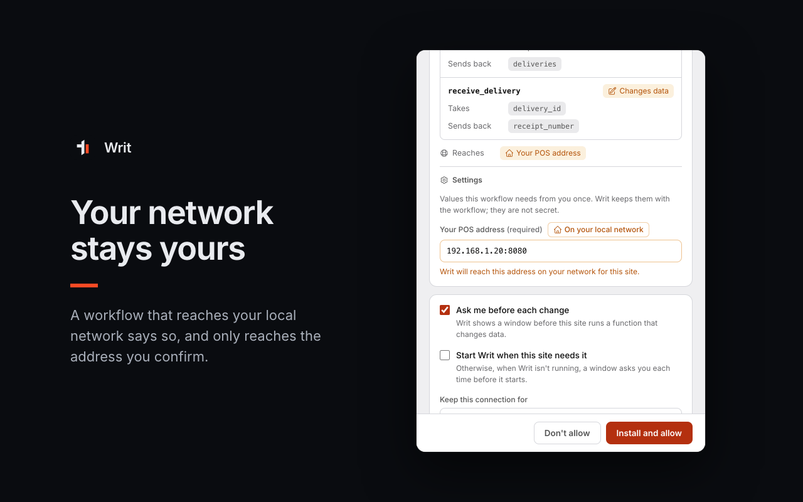
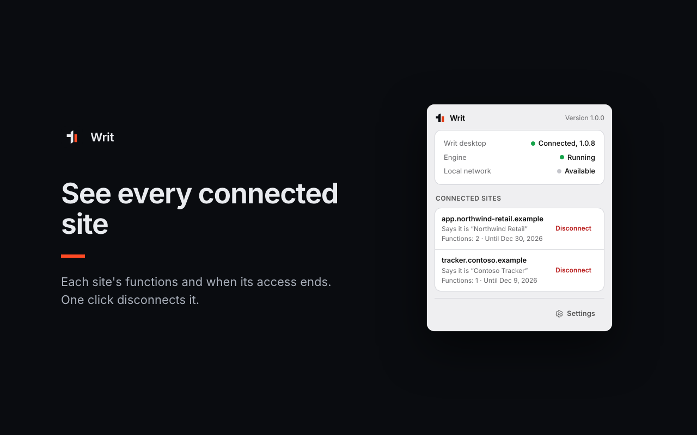

# What your users see and control

This page describes, screen by screen, what a person using your site goes through, and what they
can change later. Use it to write your own help pages, or to check that nothing surprises your
users.

## 1. Getting set up

A user needs two things on their computer:

- **The Writ extension**, from the [Chrome Web Store](https://chromewebstore.google.com/detail/writ/aphpglonnlgemfbgjopfkbdellmfljhg). Edge installs it from there too
  (Edge asks once to allow extensions from other stores), and so do Brave, Opera and Vivaldi.
- **Writ desktop 1.0.8 or later**, from <https://usewrit.app/desktop>.

They do not need a Writ account.

When your page uses `createWritBridge` or `mountWritBanner`, a banner at the top of your page
walks them through what is missing, one step at a time: the extension ("Writ for Chrome" or
"Writ for Edge"), then Writ desktop ("Get Writ desktop" or "Update Writ desktop"), then starting
Writ, then installing your workflow. The banner re-checks when the window gets focus back, for
example after an install in another tab. It never polls in the background. It speaks English,
French and Spanish.

On Firefox, Safari and phones the banner says that this feature needs Writ in Chrome or Edge on a
computer.

When the extension is installed, it opens a welcome page once: what it does, and a live check of
the connection to Writ desktop.

## 2. The consent window

The first time your site asks, the extension opens its own window: **Let this site use Writ?**

From top to bottom, it shows:

- **Your site's address**, as the browser reports it, and the name your site gives itself, shown
  as "Says it is ..." because Writ cannot verify it. A development page on `http://` is marked
  "Development page, not encrypted".
- **What it wants:** "It wants to install a workflow in Writ on this computer and run it. Check
  what it does before you allow it. The site receives the results, never your passwords or
  sessions."
- **One card per workflow your site ships:** its name and version ("Update from 1.0.0 to 1.1.0"
  for an update), its description, and under **Requested as** each of your keys with the function
  it calls.
- **Functions:** what each one takes and sends back, with a **Changes data** badge on those that
  write.
- **Reaches:** every host the workflow calls.
- **Devices on their network:** "This website asks to reach these devices on your network", with
  the reason your site gave.
- **Sign-in details:** one field per credential, "Kept sealed in Writ on this computer and used
  only by this workflow. The site never sees them."
- **Settings:** values the workflow needs once, such as **Your POS address**, pre-filled with what
  your site suggested. An address on their network is marked **On your local network**. A value
  that replaces a saved one is marked **To confirm**.
- For a linked workflow: "Kept up to date by <publisher> from Writ Cloud".

**Connection options:**

- **Ask me before each change** (on by default): Writ shows a window before your site runs a
  function that changes data.
- **Keep this connection for** 30 days, 90 days or 1 year.
- **Start Writ when this site needs it**: when Writ isn't running and your site needs it, Writ
  starts without asking. Otherwise a window asks each time.

The buttons are **Don't allow** and **Install and allow** (or **Allow** when nothing is
installed). They stay disabled for a moment after the window appears or regains focus, so a click
meant for the page behind it cannot land on them.

When your site asks for keys without shipping a workflow, the user instead picks which of their
own Writ functions answers each request, or **Don't connect this**.

## 3. The write confirmation

Before each run of a function that changes data, while "Ask me before each change" is on:
**Allow this change?**

- "This site wants to run a function that changes data."
- **Runs:** the function. **With these values:** the inputs, shortened for display.
- A dry run says "Test run: Writ goes through the steps without changing any data."
- Buttons: **Deny** and **Allow once**.

Denying ends the call with `CONSENT_DENIED` on your side.

## 4. The start window

Writ never starts without the user. If your page connects or calls while Writ is not running, the
extension opens **Start Writ for this site?**:

- "This site wants to use Writ, which isn't running on this computer. Writ starts only if you allow
  it."
- Buttons: **Not now** and **Start Writ**.
- "To skip this question for a site, tick 'Start Writ when this site needs it' when you connect
  it."

After **Not now**, the page is not asked again until it reloads, and its requests fail with
`DAEMON_UNAVAILABLE`. Only one start window per site is open at a time.

## 5. The extension's popup

The Writ button in the toolbar shows:

- **Writ desktop**: Connected (with its version), Not installed, or Needs an update.
- **Engine**: Running or Not running, with a **Start Writ** button.
- **Local network**: Available or Not available.
- **Connected sites**: each site's address, the name it gives, how many functions it may call,
  "Until" the date its access ends, and **Disconnect**. Workflows a site installed are marked
  "Installed by this site", with their version.

**Disconnect** asks "Also remove the workflows this site installed?" with **Keep them** and
**Remove them**. A disconnect from your page (`session.disconnect()`) never removes them.

The extension's **Options** hold **Developer mode**, which lets pages on `http://localhost` and
`http://127.0.0.1` ask to use Writ. It is off by default and meant only for building a site.

## 6. In Writ desktop

- **Connect, Connected apps, Websites** lists every connected site with the workflows it may call,
  which ones it installed, and for a linked workflow whether it is "Offline" or "Withdrawn by the
  site". From there the user can change the values they gave at install (such as the POS address)
  and remove a site, with or without the workflows it installed.
- **Run history** labels runs a site started as "Website · <origin>".
- **Settings, Browser extension** shows whether the extension has connected, with install links,
  and can register the extension's link to Writ desktop again for each browser.
- Installed workflows stay walled off: Writ desktop shows that a site's workflow cannot read the
  vault, saved sign-ins or files. A workflow your site marked private shows no steps.

## What to tell your users

A short text for your own help page:

> This feature runs on your computer, through Writ. Install the Writ extension for Chrome or Edge
> and Writ desktop, then click "Install" in the banner. Writ shows you what our workflow does,
> which addresses it reaches, and asks for your sign-in details in its own window: we never see
> them. You can disconnect us at any time from the Writ button in your browser's toolbar.
